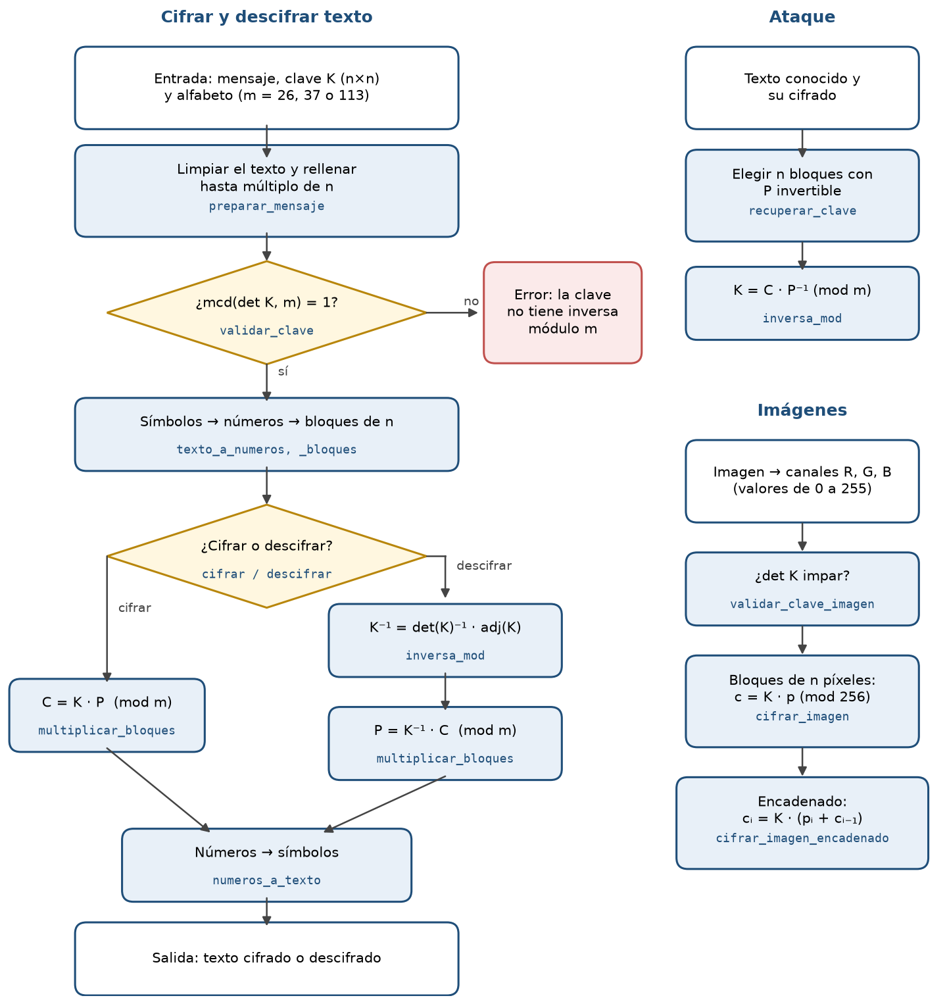
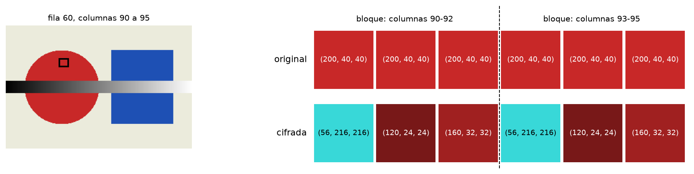
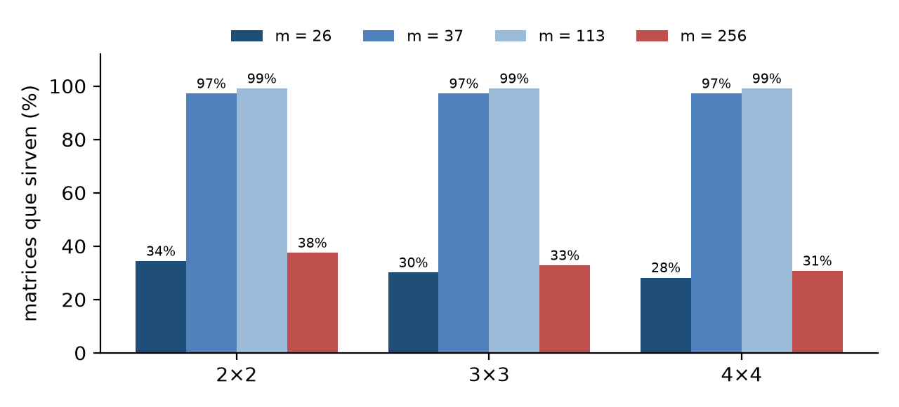
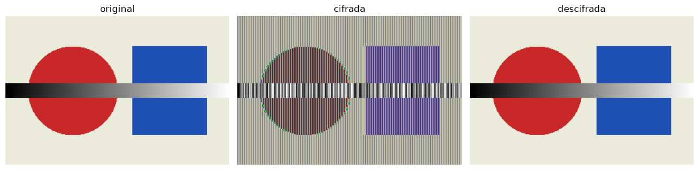
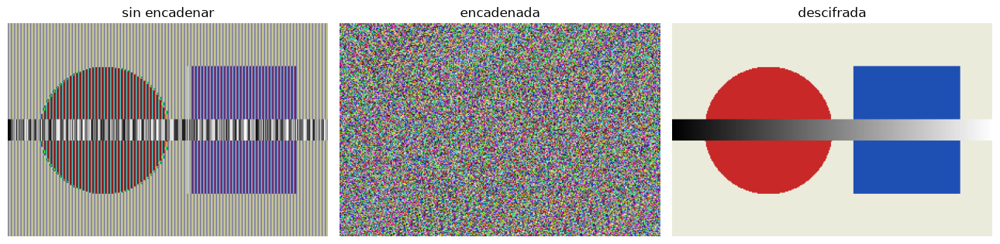
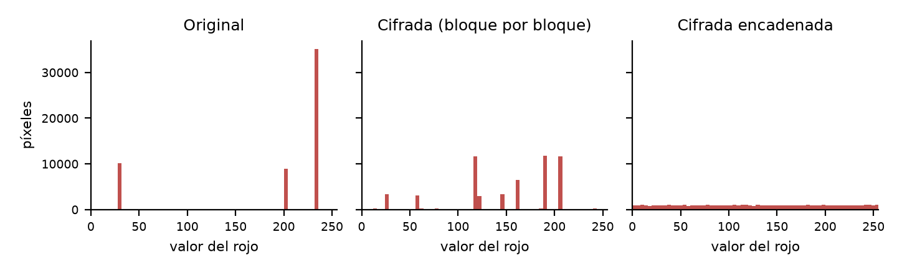

::: caratula
Universidad Francisco Marroquín

Álgebra Lineal, sección B · Segundo semestre 2026

Proyecto final

# Cifrado de Hill: álgebra lineal aplicada a la criptografía

Tema: criptografía de clave privada

**Grupo 15**

| Nombre | Carné |
|---|---|
| Milton Beltrán | 20210030 |
| Kristopher Paz | 20210408 |
| Rosemary Salguero | 20240569 |
| Luis González | 20240594 |

Repositorio: https://github.com/krisspaz/proyecto_algebra

Noviembre de 2026
:::

## 1. Introducción

**Resumen.** El cifrado de Hill (Lester Hill, 1929) convierte un mensaje en números, lo corta en bloques de `n` símbolos y multiplica cada bloque por una matriz clave `K` de `n×n`, trabajando módulo el número de símbolos del alfabeto. Para descifrar se multiplica por la inversa de la clave. En este proyecto programamos en Python el cifrado y el descifrado con claves de 2×2, 3×3 y 4×4 y tres alfabetos (26, 37 y 113 símbolos), calculamos la inversa módulo `m` con nuestras propias funciones (determinante, adjunta y Euclides extendido), atacamos el cifrado despejando la clave a partir de texto conocido y lo extendimos a imágenes, donde cada píxel ya es un trío de números de 0 a 255. También hicimos una interfaz web para usar todo esto sin programar. El resultado principal es que la misma linealidad que permite descifrar permite romper el cifrado: con unas pocas letras conocidas, la clave sale de resolver un sistema lineal.

**Objetivo general.** Aplicar matrices, determinantes e inversas al cifrado y descifrado de mensajes con el cifrado de Hill.

**Objetivos específicos.**

1. Explicar por qué una matriz sirve como clave módulo `m` solo si `mcd(det K, m) = 1`, y calcular su inversa con la adjunta.
2. Programar el cifrado, el descifrado y la inversa módulo `m` en Python, y comprobarlos con ejemplos resueltos a mano y en varios tamaños y alfabetos.
3. Mostrar que, por ser lineal, la clave se recupera resolviendo un sistema a partir de texto conocido, y medir cuánto texto hace falta.
4. Extender el método a imágenes y medir qué información deja pasar.

## 2. Marco teórico

### 2.1 El cifrado de Hill

En la criptografía de **clave privada** (o simétrica), emisor y receptor comparten una misma clave secreta que sirve para cifrar y para descifrar. En el cifrado de Hill la clave es una matriz `K` de `n×n`. Cada símbolo se convierte en un número (A=0, B=1, …, Z=25), el mensaje se corta en bloques de `n` símbolos y cada bloque, visto como vector columna `p`, se transforma así:

```
c = K · p   (mod m)          para cifrar
p = K⁻¹ · c   (mod m)        para descifrar
```

donde `m` es el número de símbolos del alfabeto. Cifrar es aplicar una transformación lineal y descifrar es aplicar su inversa, con la diferencia de que las cuentas se hacen en los enteros módulo `m` y no en los reales.

### 2.2 Aritmética módulo m e inverso modular

`Z_m = {0, 1, …, m−1}` son los residuos de dividir entre `m`; sumas y productos se reducen módulo `m`. Ahí se puede sumar, restar y multiplicar, pero **no siempre dividir**: dividir entre `a` significa multiplicar por su inverso modular `a⁻¹`, el número que cumple `a · a⁻¹ ≡ 1 (mod m)`.

**Teorema.** `a` tiene inverso módulo `m` si y solo si `mcd(a, m) = 1`.

- *Si `mcd(a, m) = 1`*: por la identidad de Bézout existen enteros `x`, `y` con `a·x + m·y = 1`. Reduciendo módulo `m` queda `a·x ≡ 1`, así que `x` es el inverso. El algoritmo de Euclides extendido lo calcula.
- *Si `mcd(a, m) = d > 1`*: `a·x` siempre es múltiplo de `d`, y `m` también, así que `a·x mod m` es múltiplo de `d` y nunca puede valer 1.

Como `26 = 2 · 13`, los números invertibles módulo 26 son los que no son pares ni múltiplos de 13. Son 12:

| a   | 1 | 3 | 5  | 7  | 9 | 11 | 15 | 17 | 19 | 21 | 23 | 25 |
|-----|---|---|----|----|---|----|----|----|----|----|----|----|
| a⁻¹ | 1 | 9 | 21 | 15 | 3 | 19 | 7  | 23 | 11 | 5  | 17 | 25 |

### 2.3 Inversa de una matriz módulo m

Sobre los enteros se cumple `K · adj(K) = det(K) · I`, donde `adj(K)` es la matriz adjunta (traspuesta de la matriz de cofactores). Como esa igualdad solo usa sumas y productos, sigue siendo cierta módulo `m`. Si `det(K)` tiene inverso modular, multiplicamos ambos lados por él:

```
K⁻¹ = det(K)⁻¹ · adj(K)   (mod m)
```

### 2.4 Cuándo una matriz sirve como clave

**Teorema.** `K` es invertible módulo `m` si y solo si `mcd(det K, m) = 1`.

- *Suficiente*: si el mcd es 1, `det(K)⁻¹` existe y la fórmula de 2.3 da la inversa.
- *Necesario*: si `K·K⁻¹ ≡ I`, tomando determinantes `det(K)·det(K⁻¹) ≡ 1`, así que `det(K)` tiene inverso y, por 2.2, `mcd(det K, m) = 1`.

En los reales basta con `det(K) ≠ 0`, pero aquí **no**. Una clave con `mcd(det K, m) > 1` no es inyectiva: dos mensajes distintos se cifran igual y nadie puede descifrar (caso 4 de la sección 4).

### 2.5 Alfabetos y módulos

El método no depende de usar 26 letras: con un alfabeto de `m` símbolos todo se hace módulo `m`. El programa ofrece tres alfabetos para texto y usa 256 para imágenes:

| Alfabeto | Símbolos | m | Factores de m | La clave sirve si… |
|---|---|---|---|---|
| Solo letras | A–Z | 26 | 2 · 13 | det no es par ni múltiplo de 13 |
| Letras, números y espacio | A–Z, 0–9, espacio | 37 | primo | det no es múltiplo de 37 |
| Todo el teclado | los 95 caracteres imprimibles del teclado, más ¡ ¿ Á É Í Ó Ú Ü Ñ á é í ó ú ü ñ € ° | 113 | primo | det no es múltiplo de 113 |
| Imágenes | valores de color de 0 a 255 | 256 | 2⁸ | det es impar |

Los dos alfabetos grandes tienen un número **primo** de símbolos a propósito. Si `m` es primo, todo número distinto de 0 tiene inverso y la regla queda como en los reales: basta `det K ≢ 0 (mod m)`. En los alfabetos que tienen espacio, el último bloque se completa con espacios en lugar de X, para que el texto descifrado se vea igual que el original.

### 2.6 Linealidad y ataque de texto plano conocido

Si un atacante conoce `n` bloques de texto plano y sus cifrados, los coloca como columnas de matrices `P` y `C`. Como cada columna cumple `c = K·p`:

```
C = K · P   ⇒   K = C · P⁻¹   (mod m)
```

siempre que `P` sea invertible módulo `m` (mismo criterio de 2.4). Recuperar la clave se reduce a **resolver un sistema lineal**: con una clave de `n×n` bastan, en el mejor caso, `n²` símbolos conocidos.

### 2.7 Imágenes como números

Una imagen digital es una cuadrícula de píxeles. En una imagen RGB de 8 bits por canal, cada píxel tiene tres números entre 0 y 255: cuánto rojo (R), cuánto verde (G) y cuánto azul (B). Por ejemplo, `(255, 0, 0)` es rojo puro, `(0, 0, 0)` es negro y `(255, 255, 255)` es blanco. Una foto de 300×200 píxeles son tres matrices de 200×300 números, una por canal.

**No se usa ASCII.** ASCII sirve para convertir caracteres de texto en números, pero una imagen ya está hecha de números: el programa trabaja directamente con los valores de los canales. Cada canal se recorre por filas y se agrupan `n` píxeles horizontales seguidos en un vector `p`, que se cifra como `c = K · p (mod 256)`. Se trabaja módulo 256 porque cada resultado tiene que volver a ser un valor entre 0 y 255. Como `256 = 2⁸`, la clave sirve si y solo si `det K` es impar.

### 2.8 Aplicaciones

- **Mensajes privados.** Con el alfabeto de 113 símbolos se cifra un mensaje tal como se escribe, con mayúsculas, tildes, ñ y signos.
- **Imágenes y archivos.** Cualquier archivo de computadora es una sucesión de bytes, es decir, de números de 0 a 255, así que el mismo cifrado módulo 256 que usamos para fotos sirve para cualquier archivo.
- **Cifrados modernos.** AES, el estándar que protege hoy las conexiones HTTPS y el wifi, usa en cada ronda el paso *MixColumns*: cada columna de 4 bytes del bloque se multiplica por una matriz invertible fija de 4×4 (con entradas 2, 3, 1, 1), con aritmética en el campo de 256 elementos GF(2⁸). Es la misma idea de Hill: mezclar un bloque multiplicándolo por una matriz invertible. La diferencia es que en AES esa matriz es pública y la clave entra por otro paso, y que se combina con pasos **no lineales** (las S-boxes), justamente para evitar el ataque de 2.6.

## 3. Explicación del código

El programa está en Python y separa cada parte del álgebra en su propio módulo. La figura 1 muestra el flujo.

| Módulo | Qué hace |
|---|---|
| `inversa.py` | Inverso modular (Euclides extendido), determinante por cofactores, adjunta, inversa módulo `m` y producto de matrices módulo `m`. Todo hecho a mano, con listas. |
| `hill.py` | Los tres alfabetos; convierte texto en números y números en texto; limpia el mensaje (mayúsculas y tildes según el alfabeto) y lo rellena; valida la clave con `mcd(det K, m) = 1`; cifra y descifra. |
| `ataque.py` | `recuperar_clave`: busca `n` bloques conocidos que formen una `P` invertible y calcula `K = C · P⁻¹`. Si no encuentra, explica por qué. |
| `imagen.py` | Cifrado de imágenes módulo 256, bloque por bloque y encadenado; `explicar_bloque` muestra la cuenta de un bloque de píxeles. |
| `app.py`, `templates/`, `static/` | Interfaz web (Flask). Python hace todas las cuentas; el navegador solo muestra los resultados. |
| `resultados.py` | Experimentos de la sección 5 (tablas y gráficas). |
| `tests/` | 35 pruebas automáticas. |
| `cifrado_hill.ipynb` | Notebook con los ejemplos, las cuentas y las figuras. |

{width=82%}

**Cifrar y descifrar** (`hill.cifrar` y `hill.descifrar`). Primero `preparar_mensaje` deja solo símbolos del alfabeto (por ejemplo, con 26 letras pasa "mañana" a "MANANA") y rellena el final hasta tener un múltiplo de `n`. Después `validar_clave` calcula `det K` con nuestra función `determinante` y comprueba `mcd(det K, m) = 1`; si no se cumple, el programa se detiene y explica por qué la clave no sirve. `texto_a_numeros` y `_bloques` arman la matriz `P`, con un bloque por columna, y `multiplicar_bloques` calcula `K · P (mod m)` de una sola vez. Para descifrar se hace lo mismo con `inversa_mod(K, m)` en lugar de `K`.

**La función crítica: la inversa módulo m.** Es la que hace posible descifrar y atacar. Implementa la fórmula de 2.3 tal cual:

```python
def inverso_modular(a, m):
    # euclides extendido: busca x tal que a*x = 1 (mod m)
    a = a % m
    r0, r1 = m, a
    x0, x1 = 0, 1
    while r1 != 0:
        q = r0 // r1
        r0, r1 = r1, r0 - q * r1
        x0, x1 = x1, x0 - q * x1
    # al terminar, r0 es el mcd(a, m)
    if r0 != 1:
        raise ValueError(f"{a} no tiene inverso modulo {m}, mcd({a}, {m}) = {r0}")
    return x0 % m

def inversa_mod(A, m):
    det = determinante(A) % m
    det_inv = inverso_modular(det, m)  # aqui falla si mcd(det, m) != 1
    adj = adjunta(A)
    inv = []
    for fila in adj:
        inv.append([(det_inv * x) % m for x in fila])
    return inv
```

`determinante` desarrolla por cofactores en la primera fila (de forma recursiva) y `adjunta` arma la traspuesta de los cofactores. Por eso el programa funciona igual con claves de 2×2, 3×3 o 4×4 y con cualquier módulo.

**Librerías y funciones propias.** El álgebra del proyecto (determinante, adjunta, inverso modular, inversa módulo `m`, validación de la clave, ataque y encadenamiento) son funciones nuestras. Las librerías se usan para lo demás: `sympy` para guardar las matrices del texto y multiplicarlas, y como comprobación (`python inversa.py` compara nuestra inversa con la de sympy en 2×2, 3×3 y 4×4 y módulos 26, 37, 113 y 256, y coinciden en los 12 casos); `numpy` para multiplicar los cientos de miles de bloques de una imagen; `Pillow` para abrir y guardar imágenes; `matplotlib` para las gráficas, y `Flask` para la interfaz web.

**Ataque e imágenes.** `recuperar_clave` toma el texto conocido y su cifrado, prueba combinaciones de `n` bloques hasta encontrar una `P` invertible (usa la misma validación de la clave) y devuelve `C · P⁻¹`. En `imagen.py`, `cifrar_imagen` convierte cada canal en una lista de bloques de `n` píxeles, multiplica todos por `K` y los vuelve a poner en su lugar; `cifrar_imagen_encadenado` hace lo mismo bloque por bloque, sumando antes el bloque cifrado anterior (sección 5.4).

## 4. Realización de varios casos

Todos los casos se calcularon con el programa y se pueden repetir en la interfaz web o en el notebook.

### Caso 1. Clave 2×2, módulo 26 (resuelto a mano)

Clave `K = [[3, 3], [2, 5]]`, mensaje "HELP".

1. `det(K) = 3·5 − 3·2 = 9`, `mcd(9, 26) = 1` → clave válida.
2. Bloques: `HE = (7, 4)`, `LP = (11, 15)`.
3. Cifrado: `K·(7, 4) = (33, 34) ≡ (7, 8)` → "HI"; `K·(11, 15) = (78, 97) ≡ (0, 19)` → "AT". Resultado: **"HIAT"**.
4. Inversa: `9⁻¹ ≡ 3` (porque `27 ≡ 1`), `adj(K) = [[5, −3], [−2, 3]]`, entonces `K⁻¹ = 3·adj(K) = [[15, −9], [−6, 9]] ≡ [[15, 17], [20, 9]]`.
5. Comprobación: `K⁻¹·(7, 8) = (241, 212) ≡ (7, 4)` → "HE". ✓

### Caso 2. Clave 3×3, módulo 37 (letras, números y espacio)

Clave `K = [[2, 5, 7], [3, 8, 1], [4, 6, 11]]`, mensaje "Nos vemos en el aula 204 a las 9 30". En este alfabeto A–Z valen 0 a 25, los dígitos 0–9 valen 26 a 35 y el espacio vale 36.

- `det K = −79 ≡ 32 (mod 37)`, `mcd(32, 37) = 1` → válida. `32⁻¹ ≡ 22` (porque `32·22 = 704 = 19·37 + 1`).
- `adj(K) = [[82, −13, −51], [−29, −6, 19], [−14, 8, 1]]` y `K⁻¹ = 22·adj(K) ≡ [[28, 10, 25], [28, 16, 11], [25, 28, 22]] (mod 37)`.
- El mensaje queda "NOS VEMOS EN EL AULA 204 A LAS 9 30 " (35 símbolos y un espacio de relleno, 12 bloques).
- Primer bloque: `NOS = (13, 14, 18)`, `K·p = (222, 169, 334) ≡ (0, 21, 1)` → "AVB". Segundo: `" VE" = (36, 21, 4)`, `K·p = (205, 280, 314) ≡ (20, 21, 18)` → "UVS".
- Cifrado completo: `AVBUVS9S89FPVD41R5P6700G27WAOUSRK79C`. Al descifrar con `K⁻¹` se recupera el mensaje con sus espacios y números.

### Caso 3. Clave 4×4, módulo 113 (todo el teclado)

Clave `K = [[1, 2, 0, 1], [0, 1, 3, 2], [2, 0, 1, 1], [1, 3, 1, 0]]`, mensaje "¿Nos vemos mañana? Aula #204, a las 9:30 (¡no faltes!)".

- `det K = −25 ≡ 88 (mod 113)`; como 113 es primo, la clave sirve. `88⁻¹ ≡ 9` (porque `88·9 = 792 = 7·113 + 1`) y `K⁻¹ ≡ [[18, 45, 5, 86], [68, 0, 45, 68], [4, 68, 86, 50], [73, 68, 18, 4]]`.
- Primer bloque: `"¿Nos" = (96, 46, 79, 83)`, `K·p = (271, 449, 354, 313) ≡ (45, 110, 15, 87)` → "Mñ/w".
- Cifrado completo (56 símbolos, con dos espacios de relleno):

```
Mñ/w7úAÚ¿+)Ü8)O(OÁRM+M)G[íJi,rym}x)/}"u)~ñ\&?!cDÚ%nZ3)"<
```

El cifrado puede tener signos, tildes y ñ, y al descifrar vuelve el mensaje exacto, con mayúsculas, tildes y signos.

### Caso 4. Una clave que no sirve

`K = [[2, 4], [6, 8]]` tiene `det = −8 ≠ 0`, así que en los reales sería invertible. Pero según el módulo:

| m | det K mod m | mcd | ¿Sirve? |
|---|---|---|---|
| 26 | 18 | 2 | No |
| 37 | 29 | 1 | Sí |
| 113 | 105 | 1 | Sí |
| 256 | 248 | 8 | No (det par) |

Módulo 26, `K · (13, 0)ᵀ = (26, 78) ≡ (0, 0)`, igual que `K · (0, 0)ᵀ`: "NA" y "AA" se cifran los dos como "AA", y es imposible saber cuál fue el mensaje. El programa la rechaza con el mensaje "Clave no invertible módulo 26: det(K) ≡ 18 y mcd(18, 26) ≠ 1". La misma matriz sí sirve módulo 37: allí "NA" se cifra como "0E".

### Caso 5. Ataque a una clave 3×3, módulo 26

Con `K = [[6, 24, 1], [13, 16, 10], [20, 17, 15]]` (det 441), el mensaje "Ataquen al amanecer por el flanco norte" se cifra como `OSLIWSLTJCKWUTUFGWCAFPVCCURUKJQTV`. El atacante conoce el inicio, "ATAQUENALAMANECERPOR".

- Con 17 letras (5 bloques completos) no alcanza: las 10 formas de elegir 3 bloques dan una `P` con determinante par o múltiplo de 13.
- Con 20 letras hay 6 bloques (ATA, QUE, NAL, AMA, NEC, ERP). El programa encuentra que ATA, NAL y ERP sirven: `det P = −2869 ≡ 17`, `mcd(17, 26) = 1`.

```
P = [[0, 13, 4], [19, 0, 17], [0, 11, 15]]      (ATA, NAL, ERP)
C = [[14, 11, 5], [18, 19, 6], [11, 9, 22]]     (OSL, LTJ, FGW)
P⁻¹ ≡ [[15, 11, 13], [23, 0, 6], [23, 0, 13]]
K = C · P⁻¹ ≡ [[6, 24, 1], [13, 16, 10], [20, 17, 15]]   ← la clave exacta
```

### Caso 6. Imagen, módulo 256

Con la misma clave del caso 5 (`det = 441`, impar), en la imagen de prueba los píxeles de la fila 60, columnas 90 a 92, están dentro del círculo rojo y valen los tres `(200, 40, 40)`:

```
Rojo:           p = (200, 200, 200)ᵀ   K·p = (6200, 7800, 10400)ᵀ   ≡ (56, 120, 160)ᵀ
Verde y azul:   p = (40, 40, 40)ᵀ      K·p = (1240, 1560, 2080)ᵀ    ≡ (216, 24, 32)ᵀ
```

| Columna | 90 | 91 | 92 |
|---|---|---|---|
| Original (R, G, B) | (200, 40, 40) | (200, 40, 40) | (200, 40, 40) |
| Cifrado (R, G, B) | (56, 216, 216) | (120, 24, 24) | (160, 32, 32) |



**La matriz cambia el color, no el lugar del píxel**: cada píxel cifrado sigue en la misma fila y columna, pero con otros valores de R, G y B. Cada valor nuevo mezcla los tres píxeles del bloque en ese mismo canal; por ejemplo, el rojo nuevo de la columna 91 es `13·200 + 16·200 + 10·200 = 7800 ≡ 120`. Los canales no se mezclan entre sí. Para descifrar se multiplica cada bloque por `K⁻¹ (mod 256)` y la imagen descifrada coincide píxel a píxel con la original.

## 5. Resultados

### 5.1 El programa funciona en todos los tamaños y alfabetos

Las 35 pruebas automáticas pasan. Comprueban, entre otras cosas, que cifrar y luego descifrar devuelve el mensaje original con claves de 2×2, 3×3 y 4×4 en los tres alfabetos, que las claves inválidas se rechazan, que el ataque recupera la clave exacta, que las imágenes se descifran píxel a píxel (también con anchos que no son múltiplo de `n`) y que la interfaz web responde bien a entradas inválidas.

| Grupo de pruebas | Pruebas |
|---|---|
| Alfabetos (símbolos, limpieza, tildes) | 6 |
| Cifrado y descifrado | 5 |
| Ataque | 3 |
| Imágenes | 5 |
| Resultados de esta sección | 2 |
| Interfaz web (API) | 14 |

Además, nuestra inversa módulo `m` coincide con la de sympy y cumple `K · K⁻¹ ≡ I` en los 12 casos probados (3 tamaños × 4 módulos).

### 5.2 ¿Cuántas matrices sirven como clave?

Una matriz al azar es invertible módulo un primo `p` con probabilidad `(1 − 1/p)(1 − 1/p²)⋯(1 − 1/pⁿ)`: la primera columna no puede ser cero, la segunda no puede ser múltiplo de la primera, y así. Si `m` tiene varios factores primos, la matriz tiene que ser invertible módulo cada uno, y las probabilidades se multiplican. La tabla compara esa fórmula con el porcentaje de 4000 matrices sorteadas al azar que pasan `validar_clave` (fórmula / simulación):

| Tamaño | m = 26 | m = 37 | m = 113 | m = 256 |
|---|---|---|---|---|
| 2×2 | 34.4 % / 34.2 % | 97.2 % / 96.8 % | 99.1 % / 99.3 % | 37.5 % / 36.8 % |
| 3×3 | 30.1 % / 30.2 % | 97.2 % / 97.2 % | 99.1 % / 99.2 % | 32.8 % / 33.7 % |
| 4×4 | 28.2 % / 29.0 % | 97.2 % / 97.4 % | 99.1 % / 99.0 % | 30.8 % / 31.1 % |

En el caso 2×2 módulo 26 contamos además las 26⁴ = 456 976 matrices una por una: sirven exactamente **157 248**, lo mismo que da la fórmula.



Con módulos primos (37 y 113) casi cualquier matriz sirve. Con 26 y 256, que tienen el factor 2, solo un tercio de las matrices sirve, y la proporción baja al crecer la matriz. Por eso elegimos alfabetos de tamaño primo, y por eso la interfaz ofrece un botón de «Clave aleatoria» que sortea hasta encontrar una válida.

### 5.3 ¿Cuánto texto necesita el ataque?

Para cada alfabeto y tamaño sorteamos 200 claves válidas y 200 mensajes al azar, y contamos cuántos bloques del inicio del mensaje tuvo que conocer `recuperar_clave` para sacar la clave. En los 1800 intentos la clave recuperada fue exactamente la original.

| Alfabeto | n | Mínimo posible | Promedio necesario | Bastó con el mínimo | Peor caso (bloques) |
|---|---|---|---|---|---|
| Solo letras (m = 26) | 2 | 4 símbolos | 6.6 símbolos | 38 % | 13 |
| | 3 | 9 símbolos | 14.0 símbolos | 28 % | 15 |
| | 4 | 16 símbolos | 22.3 símbolos | 30 % | 13 |
| Letras, números y espacio (m = 37) | 2 | 4 símbolos | 4.0 símbolos | 98 % | 3 |
| | 3 | 9 símbolos | 9.0 símbolos | 98 % | 4 |
| | 4 | 16 símbolos | 16.1 símbolos | 97 % | 5 |
| Todo el teclado (m = 113) | 2 | 4 símbolos | 4.0 símbolos | 98 % | 3 |
| | 3 | 9 símbolos | 9.0 símbolos | 100 % | 4 |
| | 4 | 16 símbolos | 16.1 símbolos | 98 % | 5 |

Una clave de 4×4 se rompe, en promedio, con unas 16 a 22 letras conocidas: un saludo o una firma al inicio del mensaje bastan. La columna «bastó con el mínimo» se parece a la tabla de 5.2, y no es casualidad: el ataque necesita que la matriz `P` de bloques conocidos sea invertible, y una `P` al azar lo es con la misma probabilidad que una clave al azar. Por eso el alfabeto primo, que facilita elegir claves, también facilita el ataque. Agrandar la clave tampoco protege: solo pide unas letras más.

### 5.4 Imágenes: lo que deja ver y cómo se arregla



En la imagen cifrada bloque por bloque **se siguen distinguiendo las figuras**. El bloque siguiente del círculo (columnas 93 a 95) vuelve a ser `(200, 40, 40)` tres veces, así que se cifra otra vez como `(56, 216, 216)`, `(120, 24, 24)`, `(160, 32, 32)`. Una zona de color uniforme da siempre el mismo bloque cifrado: el cifrado cambia los colores, pero no oculta la estructura. Es el problema del modo ECB de los cifrados modernos.

Para esconder las figuras, cada bloque se suma con el bloque cifrado anterior antes de multiplicar por la clave, y para descifrar se despeja `p_i`:

```
c_i = K · (p_i + c_{i-1})   (mod 256),   con c_0 = 0
p_i = K⁻¹ · c_i − c_{i-1}   (mod 256)
```

Así, el bloque de las columnas 90 a 92 sale `(131, 9, 245)`, `(39, 8, 159)`, `(11, 132, 197)`, y el de las columnas 93 a 95, que era idéntico, sale `(253, 82, 67)`, `(253, 53, 43)`, `(24, 24, 94)`. Es la idea del modo CBC (allí se usa XOR en lugar de suma).



Para medirlo calculamos la correlación entre cada valor de color y el del píxel que está a su derecha, y con el que está 3 lugares a la derecha (el mismo lugar del bloque siguiente). Una correlación cercana a 1 indica que los vecinos se parecen; cercana a 0, que no tienen relación.

| Imagen (300×200) | Con el píxel de al lado | Con el píxel 3 lugares a la derecha | Colores distintos |
|---|---|---|---|
| Original | 0.987 | 0.962 | 259 |
| Cifrada bloque por bloque | −0.031 | 0.738 | 183 |
| Cifrada encadenada | 0.002 | −0.005 | 40 692 |

Dentro de un bloque el cifrado sí mezcla (−0.031), pero de un bloque al siguiente la imagen cifrada se sigue pareciendo a sí misma (0.738), y por eso se ven las figuras. Además usa solo 183 colores. Encadenada, ninguna de las dos correlaciones se distingue de 0 y aparecen más de 40 000 colores. Los histogramas del canal rojo muestran lo mismo: encadenada, todos los valores aparecen casi la misma cantidad de veces.



Esto arregla la fuga de patrones, pero **no** el ataque de 2.6: el cifrado sigue siendo lineal. Si el atacante conoce los `p_i` y ve los `c_i`, también conoce `c_{i-1}`, y con `n` bloques despeja `K = C · (P + C_anterior)⁻¹`. En el notebook (sección 7) se hace con unos pocos píxeles de la primera fila y sale la clave exacta.

## 6. Conclusiones

1. Cifrar con Hill es multiplicar por una matriz y descifrar es multiplicar por su inversa, que se calcula con la adjunta y el inverso modular del determinante.
2. Módulo `m` no basta `det K ≠ 0`: la clave sirve si y solo si `mcd(det K, m) = 1`. Con `m` primo (37, 113) sirve el 97–99 % de las matrices; con 26 o 256, solo un tercio.
3. La linealidad es su debilidad: con unas `n²` letras conocidas (de 4 a 22 en promedio, según el caso) la clave sale de resolver `K = C · P⁻¹`. Agrandar la clave no lo evita.
4. Cifrar bloque por bloque deja ver los patrones de una imagen; encadenar los bloques los esconde, pero no protege la clave.
5. Por eso los cifrados modernos como AES conservan la multiplicación por una matriz, pero la combinan con pasos no lineales y encadenan los bloques.

## 7. Bibliografía

- Hill, L. S. (1929). Cryptography in an algebraic alphabet. *The American Mathematical Monthly*, 36(6), 306–312.
- Poole, D. (2011). *Álgebra lineal: una introducción moderna* (3.ª ed.). Cengage Learning.
- Stinson, D. R. y Paterson, M. B. (2018). *Cryptography: Theory and Practice* (4.ª ed.). CRC Press.
- National Institute of Standards and Technology (2001, actualizado en 2023). *Advanced Encryption Standard (AES)*, FIPS PUB 197.
- Documentación de SymPy (https://docs.sympy.org), NumPy (https://numpy.org/doc) y Pillow (https://pillow.readthedocs.io).
