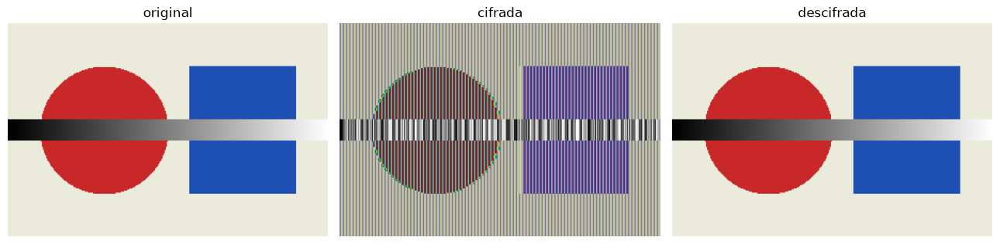
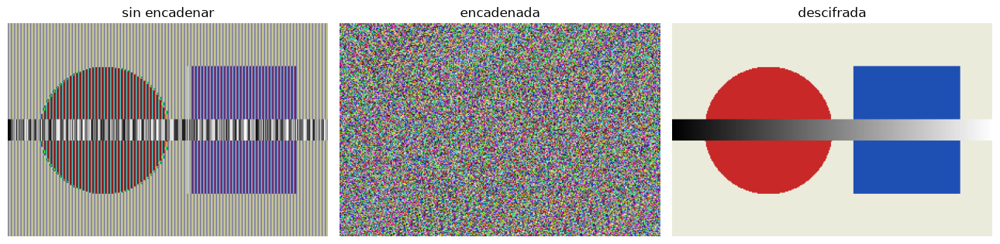

<header class="portada">

Proyecto final · Álgebra Lineal · Sección B

<h1 class="titulo">Cifrado de Hill</h1>

Álgebra lineal aplicada a la criptografía

Entrega de preliminares

Grupo15

TemaCriptografía (clave privada)

Fecha9 de noviembre de 2026

<table class="integrantes">
<thead><tr><th>Integrante</th><th>Carné</th></tr></thead>
<tbody>
<tr><td>Milton Beltrán</td><td>20210030</td></tr>
<tr><td>Kristopher Paz</td><td>20210408</td></tr>
<tr><td>Rosemary Salguero</td><td>20240569</td></tr>
<tr><td>Luis González</td><td>20240594</td></tr>
</tbody>
</table>

Repositorio: <a href="https://github.com/krisspaz/proyecto_algebra">github.com/krisspaz/proyecto_algebra</a>

</header>

## 1. Planteamiento

Dos personas quieren intercambiar mensajes que nadie más pueda leer y comparten una clave secreta. El
**cifrado de Hill** (Lester Hill, 1929) resuelve esto con álgebra lineal: la clave es una matriz
cuadrada $K$, cifrar es multiplicar por $K$ y descifrar es multiplicar por su inversa, todo módulo
el número de símbolos del alfabeto. El proyecto estudia la matemática que hace funcionar el método,
lo programa en Python y analiza por qué, siendo lineal, es fácil de romper.

## 2. Objetivos

**General.** Aplicar matrices, determinantes e inversas al cifrado y descifrado de mensajes con el
cifrado de Hill.

**Específicos.**

1. Explicar por qué una matriz sirve como clave módulo $m$ solo si $\gcd(\det K, m) = 1$, y calcular su
   inversa con la adjunta.
2. Programar el cifrado, el descifrado y la inversa módulo $m$ en Python, y comprobarlos con ejemplos
   resueltos a mano.
3. Mostrar que, por ser lineal, la clave se recupera resolviendo un sistema a partir de texto conocido.
4. Extender el método a imágenes y ver qué información deja pasar.

## 3. Fundamento

Cada letra se convierte en un número ($A=0,\ B=1,\ \dots,\ Z=25$), el mensaje se corta en bloques de
$n$ letras y cada bloque, como vector columna $\mathbf{p}$, se cifra y se descifra con

$$\mathbf{c} = K\,\mathbf{p} \pmod{26}, \qquad \mathbf{p} = K^{-1}\,\mathbf{c} \pmod{26}.$$

En $\mathbb{Z}_{26}$ se puede sumar y multiplicar, pero no siempre dividir: $a$ tiene inverso
módulo $m$ si y solo si $\gcd(a, m) = 1$ (identidad de Bézout; el inverso se calcula con el
algoritmo de Euclides extendido). Como $K\,\operatorname{adj}(K) = \det(K)\,I$ solo usa sumas y
productos, también vale módulo 26, y de ahí

$$K^{-1} = \det(K)^{-1}\,\operatorname{adj}(K) \pmod{26}.$$

::: {.teorema}
**Condición de la clave.** $K$ sirve como clave si y solo si $\gcd(\det K, 26) = 1$.
:::

::: {.izq}
A diferencia de los reales, no
basta con $\det K \neq 0$: la matriz $\begin{bmatrix}2&4\\6&8\end{bmatrix}$
tiene $\det = -8 \equiv 18$ y $\gcd(18, 26) = 2$, y de hecho cifra igual “NA” y “AA”, así que no se
puede descifrar.
:::

## 4. Ejemplo resuelto a mano

::: {.ejemplo}
Clave $K = \begin{bmatrix}3&3\\2&5\end{bmatrix}$, mensaje **HELP**.

1. $\det K = 3\cdot5 - 3\cdot2 = 9$ y $\gcd(9, 26) = 1$, así que la clave es válida.
2. Bloques: $\text{HE} = (7, 4)$ y $\text{LP} = (11, 15)$.
3. Cifrado: $K(7,4)^T = (33, 34) \equiv (7, 8) = \text{HI}$ y
   $K(11,15)^T = (78, 97) \equiv (0, 19) = \text{AT}$. Resultado: **HIAT**.
4. Inversa: $9^{-1} \equiv 3$ (porque $27 \equiv 1$) y
   $K^{-1} = 3\begin{bmatrix}5&-3\\-2&3\end{bmatrix}
   \equiv \begin{bmatrix}15&17\\20&9\end{bmatrix}$.
5. Comprobación: $K^{-1}(7,8)^T = (241, 212) \equiv (7, 4) = \text{HE}$. ✓
:::

## 5. Avance

Ya está funcionando en Python:

- **Cifrado y descifrado** de texto con claves $n\times n$ y tres alfabetos: solo letras (mod 26),
  letras, números y espacio (mod 37) y todo el teclado con tildes y signos (mod 113).
- **Inversa módulo $m$ programada a mano**: Euclides extendido, determinante por cofactores y adjunta,
  comparada contra SymPy.
- **Ataque de texto plano conocido**: con bloques de texto conocido y su cifrado se arma
  $C = KP$ y se despeja $K = C\,P^{-1} \pmod{26}$. Con una clave $3\times3$ el programa recupera la
  clave exacta a partir del inicio de un mensaje.
- **Extensión a imágenes** (mod 256): cada grupo de píxeles se cifra con la misma idea. Las figuras
  siguen viéndose en la imagen cifrada, porque bloques iguales dan cifrados iguales. Encadenando los
  bloques, $\mathbf{c}_i = K(\mathbf{p}_i + \mathbf{c}_{i-1}) \pmod{256}$, la imagen se vuelve ruido,
  aunque la clave sigue igual de expuesta al ataque.
- **Interfaz web** para cifrar, descifrar, ver el paso a paso y lanzar el ataque, un notebook
  explicativo y 26 pruebas automáticas.

<figure>

<figcaption>Cifrado por bloques sin encadenar: las figuras se siguen distinguiendo.</figcaption>
</figure>

<figure>

<figcaption>Con bloques encadenados la imagen cifrada parece ruido y se descifra exacta.</figcaption>
</figure>

## 6. Plan de trabajo

| Entrega | Fecha | Pendiente |
|---|:-:|---|
| Programa en Python | 15 nov | Pulir el código y la interfaz, ampliar ejemplos y pruebas |
| Presentación | 16 nov | Diapositivas, ejemplo en pizarra y demostración en vivo |
| Reporte | 17 nov | Informe completo con teoría, implementación, ataque, imágenes y conclusiones |

## Referencias

- Hill, L. S. (1929). Cryptography in an algebraic alphabet. *The American Mathematical Monthly*,
  36(6), 306–312.
- Poole, D. (2011). *Álgebra lineal: una introducción moderna* (3.ª ed.). Cengage Learning.
- Stinson, D. R. y Paterson, M. B. (2018). *Cryptography: Theory and Practice* (4.ª ed.). CRC Press.
